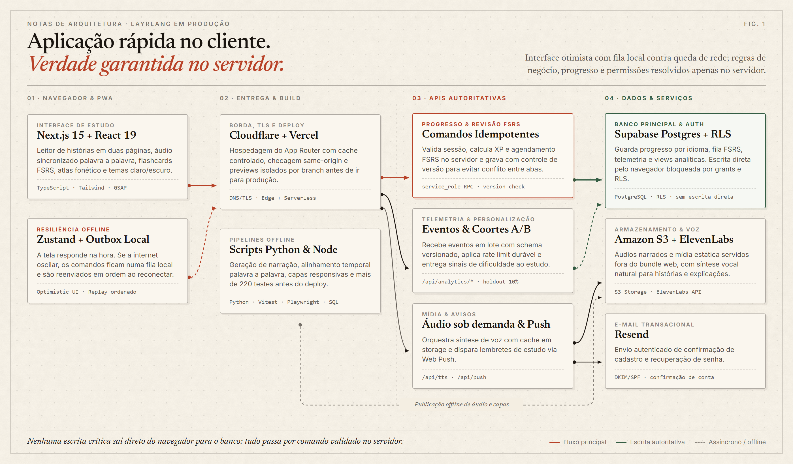
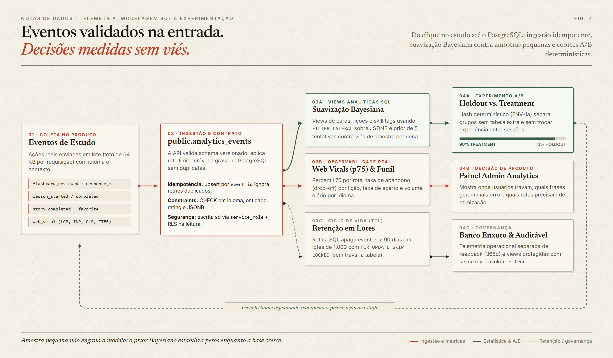

# LayrLang

**Aplicação em produção:** [layrlang.vercel.app](https://layrlang.vercel.app/)  
**Vídeo de apresentação:** [Assistir ao filme de apresentação (16:9)](https://layrlang.vercel.app/video/layrlang-film-16x9.mp4)

O LayrLang é uma plataforma web de aprendizado de idiomas focada em aprender por contexto — combinando histórias ilustradas, áudio narrado sincronizado com o texto, notas explicativas no momento da leitura e revisão espaçada (FSRS).

Este repositório documenta como o produto funciona hoje, sua arquitetura em produção e as decisões técnicas por trás da aplicação e da camada de dados. Ele não inclui código proprietário, chaves de API, migrations privadas ou o acervo completo dos cursos.

---

## Vídeo de Apresentação

*Clique na imagem acima para assistir ao vídeo de apresentação completo (também disponível na landing page em [layrlang.vercel.app](https://layrlang.vercel.app/)).*

---

## Como o Produto Funciona Hoje

O fluxo de estudo foi desenhado para transformar leitura e escuta real em vocabulário consolidado, sem depender de listas soltas de palavras:

1. **Conta e calibração:** cadastro com confirmação por e-mail/código e onboarding para definir idioma e meta diária.
2. **Área de Estudo (`/study`):** mostra o próximo passo do dia, frases vencidas para revisão e a estante de histórias organizadas por nível (A0 a C2).
3. **Leitor de Histórias (`/stories`):** layout em duas páginas (capa e controles de áudio à esquerda; texto interativo à direita), com acompanhamento palavra a palavra durante a narração, controle de velocidade, repetição de trecho, notas contextuais e retomada automática de onde o usuário parou.
4. **Flashcards com FSRS (`/flashcards`):** qualquer frase da história pode ser salva como flashcard preservando tradução, contexto e áudio original. O usuário também pode criar baralhos próprios.
5. **Sons e Pronúncia (`/sounds`):** referência prática de fonemas com transcrição IPA e áudio de comparação.
6. **Uso diário:** modo claro e modo escuro, interface adaptada para celular, suporte a PWA e lembretes via Web Push.

A trilha principal em produção é **Inglês (A0 a C2)**, com a arquitetura multi-idioma já preparada para Francês, Russo e Eslovaco.

---

## Arquitetura da Aplicação

A aplicação usa estado otimista no navegador para responder instantaneamente e mantém as regras de negócio, o cálculo de progresso e a segurança concentrados no servidor.

---

## Camada de Dados, Analytics e Experimentação

Além das telas de estudo, o banco foi estruturado para coletar eventos de aprendizado com integridade, calcular dificuldade real do conteúdo em SQL e medir o efeito de personalizações via teste A/B.

---

## Decisões Técnicas (Por que X em vez de Y)

### 1. FSRS (`ts-fsrs`) em vez de SM-2 clássico
O algoritmo SM-2 tradicional usa multiplicadores fixos que costumam penalizar demais cartas esquecidas após intervalos longos, gerando acúmulo desnecessário de revisões. O FSRS separa **dificuldade** e **estabilidade de memória**, agendando revisões mais próximas do ponto real de esquecimento.

### 2. Comandos autoritativos no servidor (`service_role`) + Outbox em vez de gravar direto do navegador no Supabase
Gravar direto do front-end via SDK acelera o primeiro protótipo, mas deixa espaço para conflito entre abas abertas e alteração indevida de progresso/XP. No modelo atual, a escrita direta nas tabelas críticas fica bloqueada para o cliente: toda mutação passa por comandos idempotentes validados no servidor com controle de versão, enquanto um outbox local garante que o usuário não perca ações se a conexão cair.

### 3. Vercel + Amazon S3 em vez de manter tudo no AWS Amplify
O primeiro deploy foi feito no AWS Amplify para aprendizado de infraestrutura AWS. Com a evolução do projeto em Next.js 15 App Router, a migração para a Vercel simplificou deploys, previews por branch e tempo de resposta das rotas, mantendo o Amazon S3 focado no que faz melhor: armazenar e entregar arquivos de áudio e mídia fora do bundle da aplicação.

### 4. Suavização Bayesiana nas views SQL em vez de média simples
Em uma base ainda crescendo, um flashcard com 2 erros em 2 tentativas teria "100% de dificuldade" numa média simples, distorcendo rankings e recomendações. As views no PostgreSQL aplicam suavização com prior de 5 tentativas (`Bayesian shrinkage`), evitando que amostras pequenas dominem o peso de dificuldade.

### 5. Teste A/B determinístico (hash FNV-1a) em vez de sorteio aleatório
Usar `Math.random()` exigiria gravar e consultar uma tabela extra de alocação para cada usuário não mudar de grupo a cada recarregamento. Com hash determinístico sobre `experiment_key + user_id`, cada pessoa cai sempre na mesma coorte (`10% holdout` / `90% treatment`) com custo zero de armazenamento extra.

### 6. Expurgo de telemetria em lotes (`SKIP LOCKED`) em vez de `DELETE` direto
Eventos operacionais têm vida útil definida (90 dias para telemetria e 365 dias para feedback). Apagar tudo em um único `DELETE` pode gerar locks longos no PostgreSQL; a rotina de retenção remove em lotes de até 1.000 registros usando `FOR UPDATE SKIP LOCKED`, mantendo o banco enxuto sem impactar usuários ativos.

---

## Pipelines de Mídia e Qualidade

- **Áudio e conteúdo (Python + ElevenLabs):** scripts automatizados geram as narrações, fazem o alinhamento temporal palavra a palavra com o texto, otimizam capas responsivas e validam a integridade dos arquivos antes da publicação.
- **Verificações automáticas:** tipagem estrita (`tsc --noEmit`), ESLint com limite de complexidade por função, verificação de tamanho de arquivos/funções (`architecture:check`), mais de 220 testes automatizados (Vitest + Playwright) e testes SQL para validar permissões e RLS no banco.

---

## Stack Tecnológica

| Camada | Tecnologias |
| --- | --- |
| **Front-end** | Next.js 15 (App Router), React 19, TypeScript, Tailwind CSS, GSAP |
| **Estado e Repetição Espaçada** | Zustand (com outbox local), `ts-fsrs` |
| **Back-end e Banco** | Next.js Route Handlers, Supabase Auth, PostgreSQL, RLS, RPCs |
| **Dados e Analytics** | Views SQL analíticas, suavização Bayesiana, coortes A/B (FNV-1a), Core Web Vitals (p75) |
| **Mídia e Automação** | Python, ElevenLabs API, alinhamento de áudio, Sharp |
| **Infraestrutura** | Vercel, Amazon S3, Cloudflare, Resend, Web Push (PWA) |
| **Qualidade e CI** | Vitest, Playwright, ESLint, TypeScript, testes SQL, GitHub Actions |

---

## Limites deste Repositório e Status

Este repositório tem foco exclusivamente documental e arquitetural — não contém código de produção, variáveis de ambiente, chaves ou conteúdo privado dos cursos.

O **LayrLang está em produção e em evolução contínua** em [layrlang.vercel.app](https://layrlang.vercel.app/).
