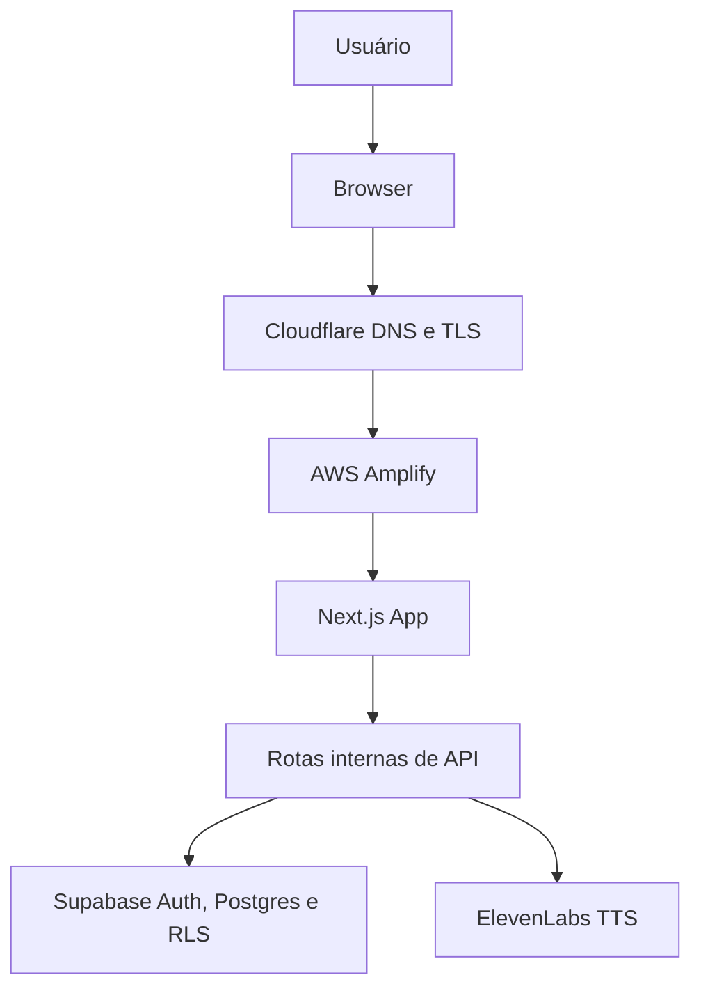

# LayrLang

Aplicação em produção: https://layrlang.vercel.app/

LayrLang é um aplicativo de aprendizado de idiomas baseado em histórias com áudio, frases úteis, flashcards e revisão espaçada. A proposta é ajudar o usuário a aprender com contexto antes de memorizar palavras soltas.

Este repositório é uma apresentação pública do projeto. Ele não contém o código de produção, chaves, backend real, banco de dados, conteúdo privado dos cursos ou regras internas proprietárias.

## Como o produto funciona

O fluxo principal do MVP é simples:

1. O usuário cria uma conta.
2. Confirma o e-mail por link ou código.
3. Passa por um onboarding inicial.
4. Entra na área de estudo.
5. Ouve histórias curtas com áudio.
6. Salva frases úteis como flashcards.
7. Revisa no momento certo.
8. Acompanha progresso, XP e continuidade de estudo.

O primeiro curso disponível em produção é Inglês.

## O que já existe no MVP

- Landing page pública.
- Guia do método.
- Cadastro e login.
- Confirmação de e-mail.
- Onboarding inicial.
- Área diária de estudo.
- Histórias com áudio.
- Flashcards e revisão.
- Treino de sons e pronúncia.
- Progresso do usuário.
- Integração com TTS.
- Deploy em ambiente real.

## Tecnologias usadas

| Área | Tecnologia |
| --- | --- |
| Aplicação | Next.js App Router |
| Interface | React e TypeScript |
| Estilo | Tailwind CSS e tokens de design |
| Animações | GSAP |
| Estado local | Zustand |
| Autenticação | Supabase Auth |
| Banco de dados | Supabase Postgres com RLS |
| Áudio | ElevenLabs |
| Hospedagem | AWS Amplify |
| Domínio e TLS | Cloudflare |
| Qualidade | TypeScript, lint, testes e build checks |

## Arquitetura atual

A arquitetura atual foi pensada para manter o MVP simples, funcional e fácil de evoluir.

## Por que essa arquitetura faz sentido agora

Permite colocar o produto no ar sem complicar a infraestrutura logo no começo.

Usa serviços gerenciados para autenticação, banco e deploy.

Mantém as regras mais importantes no servidor.

Protege os dados do usuário com RLS no Supabase.

Deixa uma base clara para evoluir sem precisar reescrever tudo depois.

## Evolução planejada

Quando o produto crescer, a arquitetura pode evoluir com CDN para os arquivos de áudio, S3 e CloudFront para os assets estáticos, logs e monitoramento mais completos, testes automatizados nos fluxos críticos e melhorias no ranking, progresso e aprendizado adaptativo.

## Limites deste repositório

Este repositório foi feito para explicar o projeto e as decisões técnicas por trás dele. Por isso, ele não inclui o código da aplicação em produção, backend real, migrations do banco, variáveis de ambiente, chaves de API, conteúdo completo dos cursos nem regras internas do sistema.

## Status

O LayrLang está em fase de MVP. A base principal já está online, mas ainda existem áreas em evolução, como progresso, ranking, conteúdo, segurança, observabilidade e refinamento de UI.
